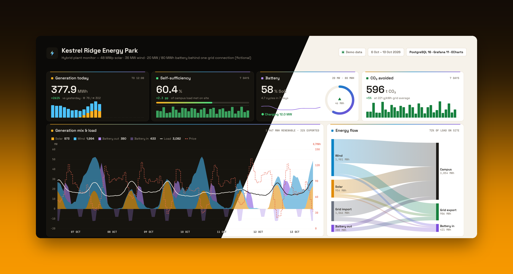
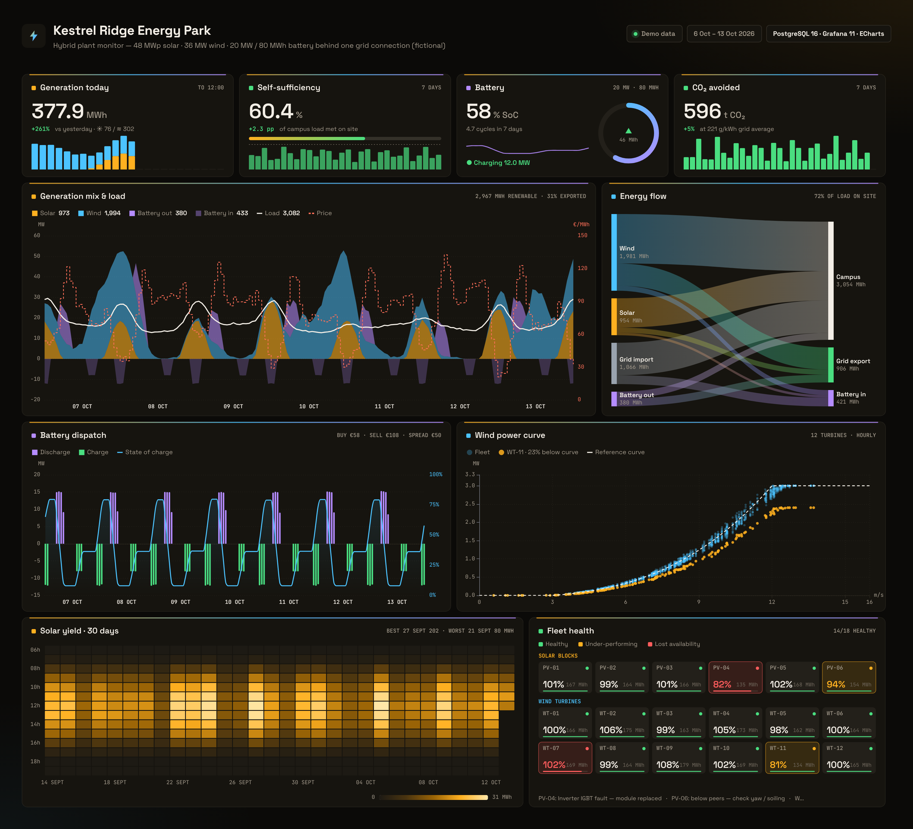
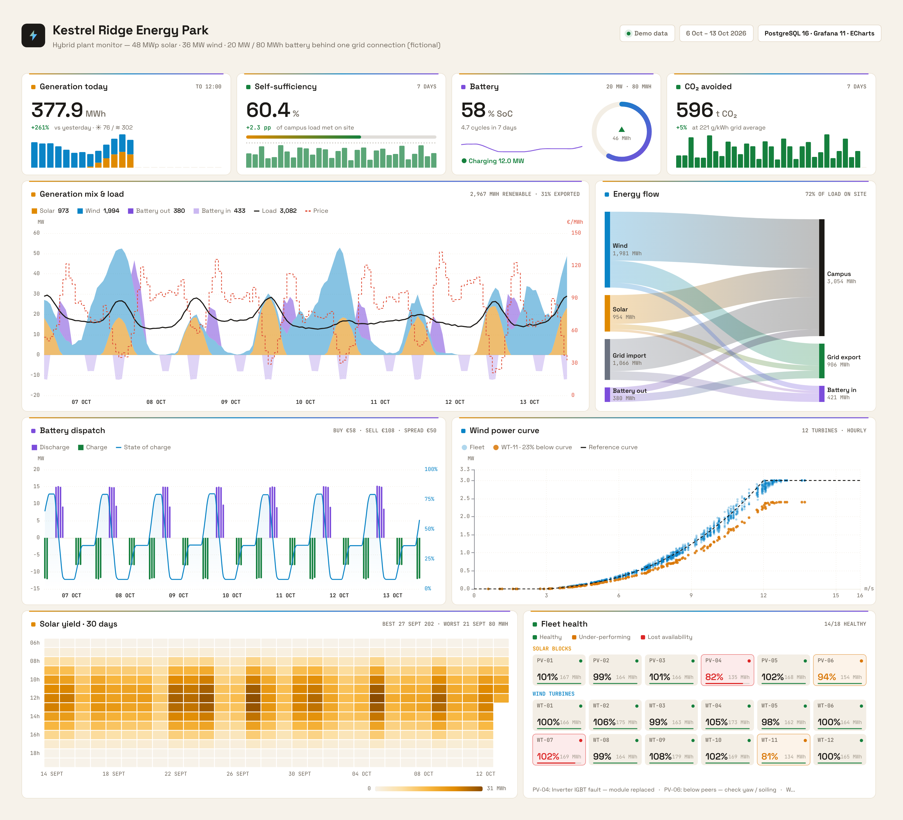

# Kestrel Ridge Energy Park · Hybrid Plant Monitor

**A monitoring dashboard for a hybrid plant with 48 MWp of solar, 36 MW of wind and a 20 MW / 80 MWh battery behind one grid connection.**
It is built with Grafana, Apache ECharts (via the Business Charts plugin) and PostgreSQL, in a warm "instrument panel" style with dark and light themes.



> Kestrel Ridge is fictional. The weather, generation, battery dispatch, campus load and market prices are all simulated by [`db/02_seed.sql`](db/02_seed.sql). The simulation includes a physical turbine power curve, PV temperature derating, inverter clipping and a step-by-step battery state-of-charge model.

---

## What the dashboard answers

| Panel | Question it answers | How |
|---|---|---|
| **Generation today** | How much have we generated so far today, compared with yesterday? | Solar + wind energy since midnight vs yesterday at the same hour, as hourly stacked columns |
| **Self-sufficiency** | How much of the campus load is covered on site? | 1 − import ÷ load over 7 days, plus 30 daily columns |
| **Battery** | What is the battery doing right now? | SoC ring, current mode and power, equivalent full cycles over 7 days |
| **CO₂ avoided** | What is the climate impact? | Renewable MWh × grid carbon intensity of the same hour |
| **Generation mix & load** | Who supplies the load, hour by hour, and at what price? | Stacked solar, wind and battery discharge, with charging drawn below zero, the load line and the day-ahead price as a step line |
| **Energy flow** | Where did every MWh go? | Sankey from merit-order allocation per 15-minute interval: renewables → campus → battery → export |
| **Battery dispatch** | Is the arbitrage working? | Charge and discharge bars, SoC, and the volume-weighted buy and sell prices with the spread |
| **Wind power curve** | Is any turbine losing energy without raising an alarm? | Hourly scatter per turbine against the reference curve. A turbine more than 10 % below the curve is highlighted automatically |
| **Solar yield · 30 days** | Was it cloudy, or is the plant underperforming? | Day × hour heatmap. Clouds darken a whole day, while a plant fault leaves a gap in otherwise sunny hours |
| **Fleet health** | Which units need a site visit? | One tile per block or turbine: output vs the peer median, availability bar, and status |

The planted problems are an inverter fault on PV-04, a completed gearbox inspection on WT-07, soiling on PV-06, and a yaw misalignment on WT-11 that only shows up on the power curve.

## Screenshots

| Dark | Light |
|---|---|
|  |  |

Each panel is also saved on its own in [`screenshots/panels/`](screenshots/panels).

## Run it

```bash
docker compose up
# open http://localhost:3001
```

This starts PostgreSQL 16 (schema + about 70k rows of simulated data), Grafana 11 with the [Business Charts](https://grafana.com/grafana/plugins/volkovlabs-echarts-panel/) plugin (provisioned, anonymous viewing) and a refresher. The refresher calls `plant.shift_to_now()` every 15 minutes to move the data forward in whole hours, so the hourly market data stays aligned.

## Data model

```
plant.asset (PV-01..06, WT-01..12, BESS)
plant.weather      (ts, ghi_wm2, wind_ms, temp_c)          15-min met mast
plant.asset_power  (ts, asset_id, mw)                      15-min, BESS signed (+ discharge)
plant.bess_state   (ts, soc_pct)
plant.site_meter   (ts, load_mw, import_mw, export_mw)     point of connection
plant.market       (ts, price_eur_mwh, grid_gco2_kwh)      hourly
plant.downtime     (asset_id, start_ts, end_ts, kind, reason)
```

## Design notes

- **One colour per energy source**: solar amber, wind sky, storage violet, grid slate and export green. Every panel uses the same colours, and a spectrum hairline in those colours tops each card as the visual signature.
- **Instrument-style typography**: Space Grotesk for figures, JetBrains Mono for captions, axes and units.
- **Warm neutrals** (charcoal in dark, paper in light) instead of the usual blue-grey, so solar amber stands out without fighting the background.

## Project layout

```
db/                 schema, simulation seed, keep-fresh function
queries/            one .sql per panel
src/kit.js          tokens, card, tooltip, legend, resize hook
src/kpi.js          figure block + mini columns
src/panels/         one file per panel
dashboard.config.mjs  layout + query mapping
grafana/            provisioning + generated dashboard JSON
tools/              build, query runner, screenshot renderer, hero image
```

## License

MIT. The data is synthetic and the site is fictional.
